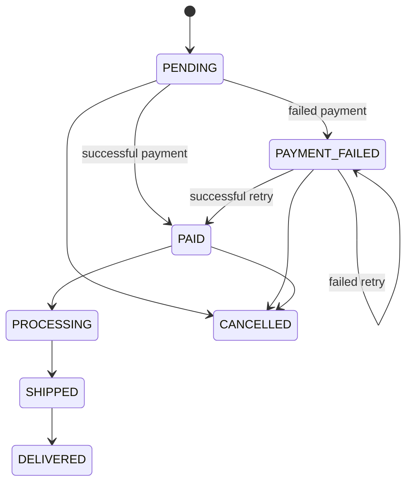

# مدل دامنه فروشگاه آنلاین

## ساختار برنامه

مدل دامنه شامل اطلاعات و رفتارهای مربوط به کاربران، محصولات، سبد خرید و سفارش‌ها است. سرویس‌ها سناریوهای برنامه را اجرا می‌کنند. منوهای CLI ورودی می‌گیرند و نتیجه را نشان می‌دهند. کلاس `Main` ساختارهای حافظه، سرویس‌ها و منوها را به هم وصل می‌کند.

| بخش | مسئولیت | وابستگی مجاز |
| --- | --- | --- |
| Model | داده‌ها، اشیاء مقداری و قوانین داخلی هر شیء | کتابخانه استاندارد جاوا و کلاس‌های Model |
| Service | ثبت‌نام، کاتالوگ، سبد، پرداخت، سفارش و نظر | Model، استثناها و ابزارهای عمومی |
| CLI | دریافت ورودی، نمایش خروجی و انتخاب عملیات | Service و Model |
| Main | ساخت Mapهای مشترک و اتصال اجزای برنامه | همه اجزای لازم برای راه‌اندازی |

داده‌ها در Map و List نگهداری می‌شوند. ذخیره‌سازی لایه جداگانه ندارد و با بستن برنامه، داده‌ها از بین می‌روند. پوشه‌های `util` و `exception` ابزار کمکی هستند.

## موجودیت‌ها و اشیاء مقداری

| نوع | کلاس‌ها | ملاک |
| --- | --- | --- |
| Entity | `User`, `Product`, `Cart`, `Order` | هویت ثابت و وضعیت قابل تغییر؛ برابری بر اساس شناسه |
| Value Object | `Money`, `Quantity`, `ContactInfo`, `CartItem`, `OrderItem`, `Address` | تغییرناپذیر؛ تغییر با ساخت مقدار جدید انجام می‌شود |
| Value Object (immutable record) | `Category`, `Coupon`, `Review`, `PaymentTransaction` | رکورد تغییرناپذیر؛ شناسه یا کد برای جستجو و ارجاع استفاده می‌شود و برابری رکورد، مقداری است |
| Enum | `UserRole`, `OrderStatus`, `PaymentMethod`, `PaymentStatus` | مجموعه مقادیر مجاز |

رکوردهای تغییرناپذیر در بسته `model.vo` قرار دارند. شناسه آدرس، محلی به دفترچه آدرس است؛ سفارش همان مقدار تغییرناپذیر آدرس زمان خرید را نگه می‌دارد. تغییر آدرس پروفایل، آدرس سفارش قبلی را تغییر نمی‌دهد.

## ارتباط‌ها و تعداد آن‌ها

| مبدأ | مقصد | جهت و تعداد | توضیح |
| --- | --- | --- | --- |
| User | Address | یک کاربر → صفر تا چند آدرس | دفترچه آدرس متعلق به کاربر است؛ حداکثر یک پیش‌فرض |
| User | Cart | یک کاربر → صفر یا یک سبد؛ هر سبد → یک کاربر | سبد در اولین استفاده ساخته می‌شود؛ شناسه مالک ثابت است |
| User | Order | یک کاربر → صفر تا چند سفارش؛ هر سفارش → یک کاربر | ارتباط با `userId` |
| Cart | CartItem | یک سبد → صفر تا چند قلم | برای هر محصول حداکثر یک قلم |
| CartItem | Product | هر قلم → یک شناسه محصول | نام و قیمت هنگام افزودن در قلم ذخیره می‌شوند |
| Product | Category | هر محصول → یک دسته؛ هر دسته → صفر تا چند محصول | ارتباط با `categoryId`؛ دسته باید موجود و فعال باشد |
| Order | OrderItem | هر سفارش → یک یا چند قلم | اقلام و قیمت‌ها پس از ثبت سفارش ثابت هستند |
| OrderItem | Product | هر قلم → یک شناسه محصول | غیرفعال‌کردن محصول، سابقه سفارش را حذف نمی‌کند |
| Order | Address | هر سفارش → یک آدرس ارسال | فقط آدرس متعلق به همان مشتری قابل انتخاب است |
| Order | PaymentTransaction | یک سفارش → صفر تا چند تراکنش | شکست‌های پرداخت هم ثبت می‌شوند |
| Review | User / Product | هر نظر → یک کاربر و یک محصول | ثبت نظر نیاز به خرید پرداخت‌شده دارد |
| Checkout | Coupon | هر بار خرید → صفر یا یک کد تخفیف | مبلغ تخفیف در سفارش ثبت می‌شود؛ کد کوپن در سفارش نگهداری نمی‌شود |
| Product / CartItem / OrderItem / Order | Money / Quantity | هر مقدار مالی یا تعداد → یک مقدار معتبر | مبلغ نامنفی، ارز یکسان و تعداد مثبت |

سرویس‌ها مالک Mapهای مربوط به خود هستند. `AuthService` و `UserService` یک Map مشترک کاربران دارند. `OrderService` به سرویس محصول، سبد و کاربر وابسته است. `ReviewService` از سرویس سفارش برای بررسی خرید استفاده می‌کند. منوهای مهمان و مشتری، `CatalogMenu` مشترک دارند.

## قوانین و رفتارها

1. ثبت‌نام حداقل به ایمیل یا موبایل نیاز دارد. هر مورد واردشده باید معتبر و غیرتکراری باشد. `ContactInfo` فرمت را بررسی می‌کند؛ `AuthService` و `UserService` تکراری‌نبودن را بررسی می‌کنند.
2. ورود با ایمیل یا موبایل انجام می‌شود. رمز به صورت هش نگهداری می‌شود و در پروفایل نمایش داده نمی‌شود. خروج، توکن همان نشست را باطل می‌کند. بازیابی رمز، نشست‌های قبلی کاربر را هم باطل می‌کند.
3. بازیابی رمز در این نسخه شبیه‌سازی کنسولی است: کد در کنسول نشان داده می‌شود، ده دقیقه اعتبار دارد و بعد از استفاده حذف می‌شود. ارسال واقعی ایمیل یا پیامک وجود ندارد.
4. در کاتالوگ مشتری فقط محصول فعالِ دسته فعال نمایش داده می‌شود. خرید محصولی که بعد از افزودن به سبد غیرفعال شده باشد، در checkout و پیش از پرداخت رد می‌شود.
5. تعداد هر قلم مثبت است و از موجودی بیشتر نمی‌شود. افزودن دوباره یک محصول، تعداد همان قلم را افزایش می‌دهد. قیمت‌ها از داده‌های سیستم گرفته می‌شوند.
6. جستجو حداکثر ۱۰۰ کاراکتر و متن نظر حداکثر ۲۰۰۰ کاراکتر است. امتیاز بین ۱ تا ۵ است. آدرس به تلفن معتبر و کد پستی ده‌رقمی نیاز دارد.
7. قیمت نهایی برابر مجموع اقلام، منهای تخفیف، به علاوه هزینه ارسال است. هزینه ارسال در این نسخه صفر است. کوپن باید منقضی نشده باشد و شرط حداقل خرید را داشته باشد.
8. موفقیت پرداخت فقط برای سفارش قابل پرداخت ثبت می‌شود. موجودی همه اقلام قبل از هر کسر بررسی می‌شود. شکست پرداخت موجودی را تغییر نمی‌دهد و امکان تلاش دوباره وجود دارد.
9. در پرداخت، فقط قلم‌های سبدی حذف می‌شوند که از checkout تا پرداخت تغییر نکرده‌اند. اقلام جدید، قلم حذف و دوباره اضافه‌شده، و قلم با تعداد ویرایش‌شده حفظ می‌شوند. سفارش و سبد بعدی مستقل‌اند.
10. لغو سفارش پرداخت‌شده موجودی را برمی‌گرداند. مسیر `updateOrderStatus(..., CANCELLED)` هم از همان منطق لغو استفاده می‌کند. لغو دوباره مجاز نیست.
11. مشتری فقط جزئیات، پرداخت و لغو سفارش متعلق به خودش را انجام می‌دهد. overloadهای شامل `userId` برای منوی مشتری‌اند. overloadهای بدون `userId` برای هماهنگی داخلی و عملیات مدیریتی باقی مانده‌اند و به مشتری نمایش داده نمی‌شوند.
12. فقط نقش ADMIN وارد پنل مدیریت می‌شود. مدیر همه سفارش‌ها را می‌بیند و بر اساس وضعیت فیلتر می‌کند. نقش STOREKEEPER در enum باقی مانده، اما مجوز پنل مدیر ندارد.
13. تصاویر به صورت URLهای HTTP/HTTPS معتبر ذخیره و در جزئیات محصول چاپ می‌شوند. مدیر می‌تواند این فهرست را تغییر دهد. کنسول فایل تصویر را نمایش نمی‌دهد.
14. مرتب‌سازی جدیدترین بر اساس `createdAt` و محبوب‌ترین بر اساس مجموع تعداد اقلام در پرداخت‌های موفق است. این شمارنده تجمعی است و با لغو سفارش کم نمی‌شود.

## وضعیت سفارش



## نگاشت داستان‌های کاربری به کد

| داستان | عملیات اصلی | محل اجرا یا محدودیت |
| --- | --- | --- |
| 1 | `AuthService.register` | GuestMenu؛ ایمیل یا موبایل معتبر و یکتا |
| 2 | `AuthService.login` | GuestMenu؛ ایمیل یا موبایل و رمز صحیح |
| 3 | `MainMenuController.handleLogout`, `GuestMenu.logout` | حذف نشست و بازگشت به مهمان |
| 4 | `requestPasswordReset`, `resetPassword` | GuestMenu؛ حساب ثبت‌شده و کد معتبر |
| 5 | `UserService.getProfile` | CustomerMenu؛ رمز نمایش داده نمی‌شود |
| 6 | `UserService.updateProfile` | CustomerMenu؛ نام معتبر و موبایل غیرتکراری |
| 7 | `addAddress`, `updateAddress`, `removeAddress`, `setDefaultAddress` | CustomerMenu؛ دفترچه همان کاربر |
| 8 | `ProductService.getAllActiveProducts` | CatalogMenu و CustomerMenu |
| 9 | `getProductById`, `getImageUrls`, `getProductReviews` | CatalogMenu؛ نام، شرح، قیمت، تصاویر، موجودی، دسته و نظرها |
| 10 | `searchProducts` | CatalogMenu؛ حداکثر ۱۰۰ کاراکتر |
| 11 | `filterAndSort` | CatalogMenu؛ دسته موجود، بازه قیمت معتبر |
| 12 | `filterAndSort` | قیمت صعودی/نزولی، امتیاز، جدیدترین، محبوب‌ترین |
| 13 | `getActiveCategories` | CatalogMenu؛ فقط دسته فعال |
| 14 | `getProductsByCategory` | CatalogMenu؛ دسته موجود و محصول فعال |
| 15 | `CartService.addItem` | CustomerMenu؛ موجودی کافی، تجمیع تعداد |
| 16 | `CartService.getCart`, `Cart.calculateSubtotal` | CustomerMenu؛ سبد همان کاربر |
| 17 | `updateItemQuantity` | تعداد مثبت و حداکثر برابر موجودی |
| 18 | `removeItem` | قلم باید در سبد همان کاربر وجود داشته باشد |
| 19 | `clearCart` | خالی‌شدن اقلام و مبلغ کل |
| 20 | `OrderService.checkout` | سبد غیرخالی، محصولات فعال و موجود |
| 21 | `checkout` | آدرس متعلق به همان کاربر |
| 22 | `Order.getPayableAmount` | نمایش مبلغ محاسبه‌شده پیش از پرداخت |
| 23 | `processPayment` | مبلغ از سفارش؛ پرداخت موفق تکراری رد می‌شود |
| 24 | `processPayment`, `markAsPaymentFailed` | شکست پرداخت و تلاش دوباره |
| 25 | `processPayment`, `recordTransaction` | نتیجه درگاه شبیه‌سازی می‌شود؛ مبلغ از سفارش |
| 26 | `getOrderHistory` | فقط سفارش‌های همان مشتری، همراه وضعیت |
| 27 | `getOrderDetails(userId, orderId)` | کنترل مالکیت پیش از نمایش |
| 28 | `getAllProducts` | AdminMenu؛ موجودی محصولات فعال و غیرفعال |
| 29 | `adjustStock` | AdminMenu؛ ثبت مقدار جدید در حافظه و جلوگیری از موجودی منفی |
| 30 | `ReviewService.addReview` | خرید قبلی، نظر غیرخالی با طول محدود |
| 31 | `addReview`, `Product.updateRatingStats` | امتیاز ۱ تا ۵ برای خریدار |
| 32 | `getProductReviews` | CatalogMenu؛ نمایش نام نویسنده، متن و امتیاز |
| 33 | `ProductService.addProduct` | AdminMenu؛ محصول معتبر در دسته موجود |
| 34 | `updateProduct`, `setProductImages` | AdminMenu؛ اعتبارسنجی قیمت و دسته |
| 35 | `deactivateProduct` | AdminMenu؛ جلوگیری از خرید، حفظ سابقه سفارش |
| 36 | `getAllOrders`, `getOrdersByStatus`, `updateOrderStatus` | AdminMenu؛ نمایش همه سفارش‌ها و فیلتر وضعیت |

## مشخصات کامل کلاس‌ها

در ادامه، فیلدها با نوع داده و سازنده‌ها و متدها با نوع ورودی و خروجی آمده‌اند. `void` یعنی متد مقدار برنمی‌گرداند. نوع‌های دارای پیشوند `model`، `service` و `cli` نسبت به بسته `org.example` نوشته شده‌اند. اعضای تولیدشده معمول جاوا مانند `equals` و `hashCode` هم در رکوردها آمده‌اند؛ جزئیات مصنوعی کامپایلر حذف شده‌اند.

### `org.example.Main`

Layer: Main

```java
public Main();
public static void main(String[] args);
```


### `org.example.cli.ConsoleIO`

Layer: CLI

```java
private final java.io.PrintStream out;
private final Scanner scanner;
public ConsoleIO();
public ConsoleIO(java.io.InputStream in, java.io.PrintStream out);
public ConsoleIO(Scanner scanner, java.io.PrintStream out);
private String padRight(String s, int n);
public void print(String message);
public void printDivider();
public void printError(String message);
public void printHeader(String title);
public void printInfo(String message);
public void printSuccess(String message);
public void printTable(List<String> headers, List<List<String>> rows);
public void printWarning(String message);
public void println();
public void println(String message);
public BigDecimal readBigDecimal(String prompt);
public boolean readBoolean(String prompt);
public int readInt(String prompt, int min, int max);
public String readLine(String prompt);
public String readPassword(String prompt);
public String readString(String prompt);
```


### `org.example.cli.MainMenuController`

Layer: CLI

```java
private final cli.menu.AdminMenu adminMenu;
private final service.AuthService authService;
private model.entity.User currentUser;
private final cli.menu.CustomerMenu customerMenu;
private final cli.menu.GuestMenu guestMenu;
private final cli.ConsoleIO io;
public MainMenuController(cli.menu.GuestMenu guestMenu, cli.menu.CustomerMenu customerMenu, cli.menu.AdminMenu adminMenu, cli.ConsoleIO io);
public MainMenuController(cli.menu.GuestMenu guestMenu, cli.menu.CustomerMenu customerMenu, cli.menu.AdminMenu adminMenu, service.AuthService authService, cli.ConsoleIO io);
public model.entity.User getCurrentUser();
public void handleLogout();
private void printGoodbyeBanner();
private void printWelcomeBanner();
public void setCurrentUser(model.entity.User user);
public void start();
```


### `org.example.cli.menu.AdminMenu`

Layer: CLI

```java
private final cli.ConsoleIO io;
private final service.OrderService orderService;
private final service.ProductService productService;
public AdminMenu(service.ProductService productService, service.OrderService orderService, cli.ConsoleIO io);
private void displayProductTable(List<model.entity.Product> products);
public void handleAddProduct();
public void handleDeactivateProduct();
public void handleEditProduct();
public void handleListOrders();
public void handleManageStock();
public void handleProcessOrders();
public void handleProductImages();
public void handleViewAllProducts();
public void showMenu(model.entity.User admin);
```


### `org.example.cli.menu.CatalogMenu`

Layer: CLI

```java
private final cli.ConsoleIO io;
private final service.ProductService productService;
private final service.ReviewService reviewService;
public CatalogMenu(service.ProductService productService, service.ReviewService reviewService, cli.ConsoleIO io);
private void displayProductTable(List<model.entity.Product> products);
public void handleBrowseCategories();
public void handleBrowseProducts();
public void handleFilterAndSort();
public void handleSearchProducts();
public void handleViewProductDetails();
public void showMenu();
```


### `org.example.cli.menu.CustomerMenu`

Layer: CLI

```java
private final service.CartService cartService;
private final cli.menu.CatalogMenu catalogMenu;
private final cli.ConsoleIO io;
private final service.OrderService orderService;
private final service.ProductService productService;
private final service.ReviewService reviewService;
private final service.UserService userService;
public CustomerMenu(service.UserService userService, service.CartService cartService, service.OrderService orderService, service.ProductService productService, service.ReviewService reviewService, cli.ConsoleIO io);
private void displayAddresses(List<model.vo.Address> addresses);
private void displayCart(model.entity.Cart cart);
private void displayOrderDetails(model.entity.Order o);
private void displayProductTable(List<model.entity.Product> products);
private model.entity.User getLatestProfile(String userId);
public void handleBrowseAndAddToCart(model.entity.User user);
public void handleCartManagement(model.entity.User user);
public void handleCheckout(model.entity.User user);
public void handleOrderHistory(model.entity.User user);
public void handleProfileManagement(model.entity.User user);
public void handleSubmitReview(model.entity.User user);
private void promptAddAddress(String userId);
private void promptEditAddress(String userId);
private String readOrKeep(String label, String current);
public void showMenu(model.entity.User user);
```


### `org.example.cli.menu.GuestMenu`

Layer: CLI

```java
private final service.AuthService authService;
private final cli.menu.CatalogMenu catalogMenu;
private final cli.ConsoleIO io;
private String sessionToken;
public GuestMenu(service.AuthService authService, service.ProductService productService, cli.ConsoleIO io);
public GuestMenu(service.AuthService authService, service.ProductService productService, service.ReviewService reviewService, cli.ConsoleIO io);
public String getSessionToken();
public void handleBrowseProducts();
public void handleFilterAndSort();
public model.entity.User handleLogin();
public void handlePasswordRecovery();
public void handleRegister();
public void handleSearchProducts();
public void handleViewProductDetails();
public void logout();
public model.entity.User showMenu();
```


### `org.example.exception.AuthenticationException`

Layer: Exceptions

```java
public AuthenticationException(String message);
public AuthenticationException(String message, Throwable cause);
```


### `org.example.exception.CategoryNotFoundException`

Layer: Exceptions

```java
public CategoryNotFoundException(String message);
```


### `org.example.exception.DuplicateUserException`

Layer: Exceptions

```java
public DuplicateUserException(String message);
```


### `org.example.exception.InsufficientStockException`

Layer: Exceptions

```java
public InsufficientStockException(String message);
```


### `org.example.exception.InvalidCouponException`

Layer: Exceptions

```java
public InvalidCouponException(String message);
```


### `org.example.exception.InvalidInputException`

Layer: Exceptions

```java
public InvalidInputException(String message);
```


### `org.example.exception.InvalidOrderStateException`

Layer: Exceptions

```java
public InvalidOrderStateException(String message);
```


### `org.example.exception.OrderNotFoundException`

Layer: Exceptions

```java
public OrderNotFoundException(String message);
```


### `org.example.exception.ProductNotFoundException`

Layer: Exceptions

```java
public ProductNotFoundException(String message);
```


### `org.example.exception.UnauthorizedActionException`

Layer: Exceptions

```java
public UnauthorizedActionException(String message);
```


### `org.example.exception.UserNotFoundException`

Layer: Exceptions

```java
public UserNotFoundException(String message);
```


### `org.example.model.entity.Cart`

Layer: Model

```java
private final String cartId;
private final Map<String, model.vo.CartItem> items;
private final String userId;
public Cart(String userId);
public Cart(String cartId, String userId);
public void addProduct(model.entity.Product product, model.vo.Quantity quantity);
public model.vo.Money calculateSubtotal();
private void checkRep();
public void clear();
public boolean equals(Object o);
public String getCartId();
public List<model.vo.CartItem> getItems();
public String getUserId();
public int hashCode();
public boolean isEmpty();
public int quantityOf(String productId);
public void removeCheckedOutItems(List<model.vo.CartItem> snapshot);
public void removeProduct(String productId);
public String toString();
public void updateQuantity(String productId, model.vo.Quantity newQuantity);
```


### `org.example.model.entity.Order`

Layer: Model

```java
private final LocalDateTime createdAt;
private final model.vo.Address deliveryAddress;
private final model.vo.Money discountAmount;
private final List<model.vo.OrderItem> items;
private final model.vo.Money itemsSubtotal;
private final String orderId;
private LocalDateTime paidAt;
private final model.vo.Money payableAmount;
private final model.vo.Money shippingFee;
private model.enums.OrderStatus status;
private final List<model.vo.PaymentTransaction> transactions;
private final String userId;
public Order(String orderId, String userId, List<model.vo.OrderItem> items, model.vo.Address deliveryAddress, model.vo.Money itemsSubtotal, model.vo.Money discountAmount, model.vo.Money shippingFee, model.vo.Money payableAmount, LocalDateTime createdAt);
public boolean canBeCancelled();
public void cancel();
private void checkRep();
public boolean equals(Object o);
public LocalDateTime getCreatedAt();
public model.vo.Address getDeliveryAddress();
public model.vo.Money getDiscountAmount();
public List<model.vo.OrderItem> getItems();
public model.vo.Money getItemsSubtotal();
public String getOrderId();
public Optional<LocalDateTime> getPaidAt();
public model.vo.Money getPayableAmount();
public model.vo.Money getShippingFee();
public model.enums.OrderStatus getStatus();
public List<model.vo.PaymentTransaction> getTransactions();
public String getUserId();
public int hashCode();
public void markAsPaid(LocalDateTime paymentTime);
public void markAsPaymentFailed();
public void recordTransaction(model.vo.PaymentTransaction transaction);
public String toString();
public void updateStatus(model.enums.OrderStatus newStatus);
```


### `org.example.model.entity.Product`

Layer: Model

```java
private boolean active;
private int availableStock;
private double averageRating;
private String categoryId;
private final LocalDateTime createdAt;
private String description;
private final String id;
private List<String> imageUrls;
private String name;
private model.vo.Money price;
private int reviewCount;
private long soldCount;
public Product(String id, String name, String description, model.vo.Money price, int initialStock, String categoryId);
public Product(String id, String name, String description, model.vo.Money price, int initialStock, String categoryId, LocalDateTime createdAt);
private void checkRep();
public void deductStock(model.vo.Quantity quantity);
public boolean equals(Object o);
public int getAvailableStock();
public double getAverageRating();
public String getCategoryId();
public LocalDateTime getCreatedAt();
public String getDescription();
public String getId();
public List<String> getImageUrls();
public String getName();
public model.vo.Money getPrice();
public int getReviewCount();
public long getSoldCount();
public int hashCode();
public boolean isActive();
public boolean isAvailable(model.vo.Quantity required);
public void recordSale(model.vo.Quantity quantity);
public void restock(model.vo.Quantity quantity);
public void setActive(boolean active);
public void setImageUrls(List<String> urls);
public String toString();
public void updateDetails(String name, String desc, model.vo.Money price, String categoryId);
public void updateRatingStats(int newRatingScore);
```


### `org.example.model.entity.User`

Layer: Model

```java
private boolean active;
private final List<model.vo.Address> addresses;
private final LocalDateTime createdAt;
private String email;
private String fullName;
private final String id;
private String passwordHash;
private String phone;
private model.enums.UserRole role;
public User(String id, String fullName, String email, String phone, String passwordHash, model.enums.UserRole role, LocalDateTime createdAt);
public void activate();
public void addAddress(model.vo.Address address);
public void changePassword(String newPasswordHash);
private void checkRep();
public void deactivate();
public boolean equals(Object o);
public List<model.vo.Address> getAddresses();
public LocalDateTime getCreatedAt();
public Optional<model.vo.Address> getDefaultAddress();
public String getEmail();
public String getFullName();
public String getId();
public String getPhone();
public model.enums.UserRole getRole();
public int hashCode();
public boolean isActive();
public void removeAddress(String addressId);
public void setDefaultAddress(String addressId);
public String toString();
public void updateProfile(String newFullName, String newPhone);
```


### `org.example.model.enums.OrderStatus`

Layer: Model

```java
public static final model.enums.OrderStatus CANCELLED;
public static final model.enums.OrderStatus DELIVERED;
public static final model.enums.OrderStatus PAID;
public static final model.enums.OrderStatus PAYMENT_FAILED;
public static final model.enums.OrderStatus PENDING;
public static final model.enums.OrderStatus PROCESSING;
public static final model.enums.OrderStatus SHIPPED;
private OrderStatus(String $enum$name, int $enum$ordinal);
public static model.enums.OrderStatus valueOf(String name);
public static model.enums.OrderStatus[] values();
```


### `org.example.model.enums.PaymentMethod`

Layer: Model

```java
public static final model.enums.PaymentMethod CASH_ON_DELIVERY;
public static final model.enums.PaymentMethod ONLINE_GATEWAY;
public static final model.enums.PaymentMethod WALLET;
private PaymentMethod(String $enum$name, int $enum$ordinal);
public static model.enums.PaymentMethod valueOf(String name);
public static model.enums.PaymentMethod[] values();
```


### `org.example.model.enums.PaymentStatus`

Layer: Model

```java
public static final model.enums.PaymentStatus CANCELLED;
public static final model.enums.PaymentStatus FAILED;
public static final model.enums.PaymentStatus SUCCESS;
private PaymentStatus(String $enum$name, int $enum$ordinal);
public static model.enums.PaymentStatus valueOf(String name);
public static model.enums.PaymentStatus[] values();
```


### `org.example.model.enums.UserRole`

Layer: Model

```java
public static final model.enums.UserRole ADMIN;
public static final model.enums.UserRole CUSTOMER;
public static final model.enums.UserRole STOREKEEPER;
private UserRole(String $enum$name, int $enum$ordinal);
public static model.enums.UserRole valueOf(String name);
public static model.enums.UserRole[] values();
```


### `org.example.model.vo.Address`

Layer: Model

```java
private final String addressId;
private final String city;
private final boolean isDefault;
private final String phone;
private final String postalCode;
private final String province;
private final String recipientName;
private final String streetAddress;
private final String title;
public Address(String addressId, String recipientName, String phone, String province, String city, String streetAddress, String postalCode, String title, boolean isDefault);
public String addressId();
public String city();
public final boolean equals(Object o);
public String fullAddressText();
public final int hashCode();
public boolean isDefault();
public String phone();
public String postalCode();
public String province();
public String recipientName();
public String streetAddress();
public String title();
public final String toString();
public model.vo.Address withDefault(boolean isDefault);
```


### `org.example.model.vo.CartItem`

Layer: Model

```java
private final String productId;
private final String productName;
private final model.vo.Quantity quantity;
private final model.vo.Money unitPrice;
public CartItem(String productId, String productName, model.vo.Money unitPrice, model.vo.Quantity quantity);
public final boolean equals(Object o);
public model.vo.Money getLineTotal();
public final int hashCode();
public String productId();
public String productName();
public model.vo.Quantity quantity();
public final String toString();
public model.vo.Money unitPrice();
public model.vo.CartItem withQuantity(model.vo.Quantity newQuantity);
```


### `org.example.model.vo.Category`

Layer: Model

```java
private final boolean active;
private final String description;
private final String id;
private final String name;
public Category(String id, String name, String description);
public Category(String id, String name, String description, boolean active);
public boolean active();
public String description();
public final boolean equals(Object o);
public final int hashCode();
public String id();
public String name();
public final String toString();
```


### `org.example.model.vo.ContactInfo`

Layer: Model

```java
private static final regex.Pattern EMAIL;
private static final regex.Pattern PHONE;
private final String email;
private final String phone;
public ContactInfo(String email, String phone);
public String email();
public final boolean equals(Object o);
public final int hashCode();
public boolean matches(String identifier);
public String phone();
public final String toString();
```


### `org.example.model.vo.Coupon`

Layer: Model

```java
private final String code;
private final int discountPercent;
private final LocalDate expiryDate;
private final model.vo.Money maxDiscount;
private final model.vo.Money minOrderAmount;
public Coupon(String code, int discountPercent, model.vo.Money maxDiscount, model.vo.Money minOrderAmount, LocalDate expiryDate);
public model.vo.Money calculateDiscount(model.vo.Money subtotal);
public String code();
public int discountPercent();
public final boolean equals(Object o);
public LocalDate expiryDate();
public final int hashCode();
public boolean isValid(model.vo.Money subtotal, LocalDate currentDate);
public model.vo.Money maxDiscount();
public model.vo.Money minOrderAmount();
public final String toString();
```


### `org.example.model.vo.Money`

Layer: Model

```java
public static final model.vo.Money ZERO;
private final BigDecimal amount;
private final String currency;
public Money(BigDecimal amount, String currency);
public model.vo.Money add(model.vo.Money other);
public BigDecimal amount();
public String currency();
public final boolean equals(Object o);
public final int hashCode();
public boolean isLessThan(model.vo.Money other);
public boolean isNegative();
public model.vo.Money multiply(model.vo.Quantity quantity);
public model.vo.Money subtract(model.vo.Money other);
public final String toString();
private void validateSameCurrency(model.vo.Money other);
```


### `org.example.model.vo.OrderItem`

Layer: Model

```java
private final model.vo.Money lineTotal;
private final String productId;
private final String productName;
private final model.vo.Quantity quantity;
private final model.vo.Money unitPrice;
public OrderItem(String productId, String productName, model.vo.Money unitPrice, model.vo.Quantity quantity);
public OrderItem(String productId, String productName, model.vo.Money unitPrice, model.vo.Quantity quantity, model.vo.Money lineTotal);
public final boolean equals(Object o);
public final int hashCode();
public model.vo.Money lineTotal();
public String productId();
public String productName();
public model.vo.Quantity quantity();
public final String toString();
public model.vo.Money unitPrice();
```


### `org.example.model.vo.PaymentTransaction`

Layer: Model

```java
private final model.vo.Money amount;
private final model.enums.PaymentMethod method;
private final String orderId;
private final String referenceCode;
private final model.enums.PaymentStatus status;
private final LocalDateTime timestamp;
private final String transactionId;
public PaymentTransaction(String transactionId, String orderId, model.vo.Money amount, model.enums.PaymentMethod method, model.enums.PaymentStatus status, LocalDateTime timestamp, String referenceCode);
public model.vo.Money amount();
public final boolean equals(Object o);
public final int hashCode();
public model.enums.PaymentMethod method();
public String orderId();
public String referenceCode();
public model.enums.PaymentStatus status();
public LocalDateTime timestamp();
public final String toString();
public String transactionId();
```


### `org.example.model.vo.Quantity`

Layer: Model

```java
private final int value;
public Quantity(int value);
public model.vo.Quantity add(model.vo.Quantity other);
public final boolean equals(Object o);
public final int hashCode();
public boolean isGreaterThan(model.vo.Quantity other);
public model.vo.Quantity subtract(model.vo.Quantity other);
public final String toString();
public int value();
```


### `org.example.model.vo.Review`

Layer: Model

```java
private final String authorName;
private final String commentText;
private final LocalDateTime createdAt;
private final String productId;
private final int rating;
private final String reviewId;
private final String userId;
public Review(String reviewId, String userId, String authorName, String productId, int rating, String commentText, LocalDateTime createdAt);
public String authorName();
public String commentText();
public LocalDateTime createdAt();
public final boolean equals(Object o);
public final int hashCode();
public String productId();
public int rating();
public String reviewId();
public final String toString();
public String userId();
```


### `org.example.service.AuthService`

Layer: Service

```java
private final Map<String, String> activeSessions;
private final Map<String, String> credentialsStore;
private final Map<String, service.AuthService.PasswordReset> passwordResets;
private final java.security.SecureRandom random;
private final Map<String, model.entity.User> userStore;
public AuthService();
public AuthService(Map<String, model.entity.User> userStore);
public AuthService(Map<String, model.entity.User> userStore, Map<String, String> activeSessions);
public AuthService(Map<String, model.entity.User> userStore, Map<String, String> credentialsStore, Map<String, String> activeSessions);
private model.entity.User findByIdentifier(String identifier);
public model.entity.User getAuthenticatedUser(String sessionToken);
public String login(String identifier, String password);
public void logout(String sessionToken);
 void recordCredentials(String userId, String passwordHash);
public model.entity.User register(String fullName, String email, String phone, String password);
public String requestPasswordReset(String identifier);
public void resetPassword(String identifier, String code, String newPassword);
private void validatePassword(String password);
```


### `org.example.service.AuthService.PasswordReset`

Layer: Service

```java
private final LocalDateTime expiresAt;
private final String tokenHash;
private PasswordReset(String tokenHash, LocalDateTime expiresAt);
public final boolean equals(Object o);
public LocalDateTime expiresAt();
public final int hashCode();
public final String toString();
public String tokenHash();
```


### `org.example.service.CartService`

Layer: Service

```java
private final Map<String, model.entity.Cart> cartStore;
private final service.ProductService productService;
public CartService(Map<String, model.entity.Cart> cartStore, service.ProductService productService);
public CartService(service.ProductService productService);
public void addItem(String userId, String productId, model.vo.Quantity quantity);
public void clearCart(String userId);
public model.entity.Cart getCart(String userId);
public void removeCheckedOutItems(String userId, List<model.vo.CartItem> snapshot);
public void removeItem(String userId, String productId);
public void updateItemQuantity(String userId, String productId, model.vo.Quantity newQuantity);
```


### `org.example.service.OrderService`

Layer: Service

```java
private final service.CartService cartService;
private final Map<String, List<model.vo.CartItem>> checkoutSnapshots;
private final Map<String, model.vo.Coupon> couponStore;
private final Map<String, model.entity.Order> orderStore;
private final service.ProductService productService;
private final service.UserService userService;
public OrderService();
public OrderService(Map<String, model.entity.Order> orderStore);
public OrderService(Map<String, model.entity.Order> orderStore, Map<String, model.vo.Coupon> couponStore, service.CartService cartService, service.ProductService productService, service.UserService userService);
public OrderService(service.CartService cartService, service.ProductService productService, service.UserService userService);
public boolean cancelOrder(String userId, String orderId);
public synchronized boolean cancelOrder(String orderId);
public model.entity.Order checkout(String userId, String addressId, String couponCode);
private void ensureDependenciesConfigured();
public List<model.entity.Order> getAllOrders();
public model.entity.Order getOrderDetails(String orderId);
public model.entity.Order getOrderDetails(String userId, String orderId);
public List<model.entity.Order> getOrderHistory(String userId);
public List<model.entity.Order> getOrdersByStatus(model.enums.OrderStatus status);
public boolean processPayment(String userId, String orderId, model.enums.PaymentMethod method, boolean simulateSuccess);
public synchronized boolean processPayment(String orderId, model.enums.PaymentMethod method, boolean simulateSuccess);
 void recordOrder(model.entity.Order order);
 void registerCoupon(model.vo.Coupon coupon);
public synchronized void updateOrderStatus(String orderId, model.enums.OrderStatus newStatus);
```


### `org.example.service.ProductService`

Layer: Service

```java
public static final int MAX_SEARCH_LENGTH;
private final Map<String, model.vo.Category> categoryStore;
private final Map<String, model.entity.Product> productStore;
public ProductService();
public ProductService(Map<String, model.entity.Product> productStore, Map<String, model.vo.Category> categoryStore);
public void addProduct(String name, String desc, model.vo.Money price, int stock, String categoryId);
public void adjustStock(String productId, int delta);
public void deactivateProduct(String productId);
public List<model.entity.Product> filterAndSort(String categoryId, model.vo.Money minPrice, model.vo.Money maxPrice, String sortBy);
public List<model.vo.Category> getActiveCategories();
public List<model.entity.Product> getAllActiveProducts();
public List<model.entity.Product> getAllProducts();
public model.entity.Product getProductById(String productId);
public List<model.entity.Product> getProductsByCategory(String categoryId);
private boolean isVisible(model.entity.Product product);
 void registerCategory(model.vo.Category category);
 void registerProduct(model.entity.Product product);
private model.vo.Category requireActiveCategory(String categoryId);
public model.entity.Product requireAvailableProduct(String productId, model.vo.Quantity quantity);
public List<model.entity.Product> searchProducts(String query);
public void setProductImages(String productId, List<String> imageUrls);
public void updateProduct(String productId, String name, String desc, model.vo.Money price, String categoryId);
```


### `org.example.service.ReviewService`

Layer: Service

```java
public static final int MAX_REVIEW_LENGTH;
private final service.OrderService orderService;
private final Map<String, List<model.vo.Review>> productReviewsStore;
private final service.ProductService productService;
public ReviewService(Map<String, List<model.vo.Review>> productReviewsStore, service.OrderService orderService, service.ProductService productService);
public ReviewService(service.OrderService orderService, service.ProductService productService);
public void addReview(String userId, String authorName, String productId, int rating, String comment);
public List<model.vo.Review> getProductReviews(String productId);
private boolean hasUserPurchasedProduct(String userId, String productId);
private boolean isPaidOrCompletedOrder(model.entity.Order order);
```


### `org.example.service.UserService`

Layer: Service

```java
private final Map<String, model.entity.User> userStore;
public UserService();
public UserService(Map<String, model.entity.User> userStore);
public void addAddress(String userId, model.vo.Address address);
public model.entity.User getProfile(String userId);
public void removeAddress(String userId, String addressId);
public void setDefaultAddress(String userId, String addressId);
public void updateAddress(String userId, model.vo.Address address);
public void updateProfile(String userId, String fullName, String phone);
```


### `org.example.util.DataSeeder`

Layer: Utilities

```java
private DataSeeder();
public static void seed(Map<String, model.entity.User> userStore, Map<String, String> credentialsStore, Map<String, model.vo.Category> categoryStore, service.ProductService productService, Map<String, model.vo.Coupon> couponStore);
private static void seedCategories(Map<String, model.vo.Category> categoryStore);
private static void seedCoupons(Map<String, model.vo.Coupon> couponStore);
private static void seedProducts(service.ProductService productService);
private static void seedUsers(Map<String, model.entity.User> userStore, Map<String, String> credentialsStore);
```


### `org.example.util.PasswordUtil`

Layer: Utilities

```java
private static final String HASH_ALGORITHM;
private PasswordUtil();
public static String hashPassword(String rawPassword);
public static boolean verifyPassword(String rawPassword, String storedHash);
```
